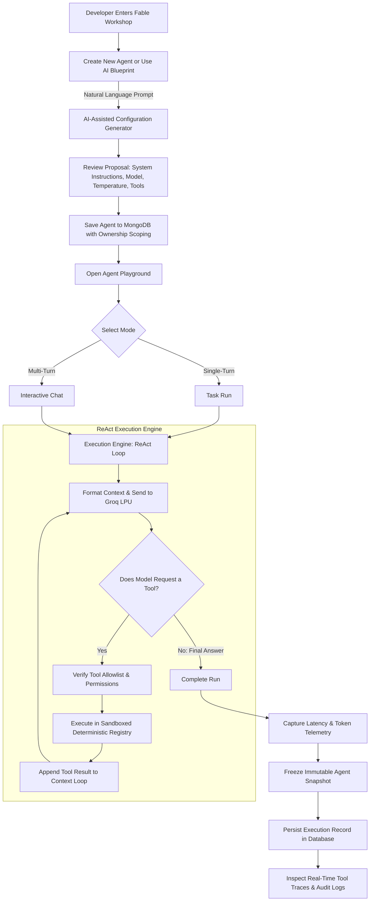

# Fable — Imagine It. Automate It.

A developer-focused platform for authoring, testing, and running autonomous AI agents with transparent execution inspection, deterministic tool sandboxes, and immutable audit logs.

---

## Table of Contents
1. [Overview & Motivation](#1-overview--motivation)
2. [How Fable Differs from ChatGPT, Gemini, and Groq](#2-how-fable-differs-from-chatgpt-gemini-and-groq)
3. [End-to-End Workflow](#3-end-to-end-workflow)
4. [System Design & Architecture](#4-system-design--architecture)
5. [Feature Highlights](#5-feature-highlights)
6. [Sandboxed Built-in Tools](#6-sandboxed-built-in-tools)
7. [Security Architecture & Tenancy](#7-security-architecture--tenancy)
8. [Data Models & Persistence Design](#8-data-models--persistence-design)
9. [Prerequisites & Getting Started](#9-prerequisites--getting-started)
10. [Automated Testing & Test Isolation](#10-automated-testing--test-isolation)
11. [API Endpoint Directory](#11-api-endpoint-directory)
12. [Performance & Production Readiness](#12-performance--production-readiness)
13. [Deployment Guide for Operators](#13-deployment-guide-for-operators)
14. [License](#14-license)

---

## 1. Overview & Motivation

Modern Large Language Models (LLMs) are exceptionally capable reasoning engines, but deploying them into real-world autonomous tasks requires far more than a raw chat prompt. Autonomous agents need:
- **Defined Personas & Constraints**: Clear instructions and bounds on what they can and cannot do.
- **Deterministic Tool Access**: Safe ways to interact with computation, string processing, and time calculation without arbitrary code execution risks.
- **Auditable Execution Telemetry**: Granular visibility into *why* an agent made a decision, *which* tools it invoked, what arguments it passed, how long each step took, and how many tokens were consumed.
- **Immutable Snapshots**: A frozen, reproducible record of the exact agent configuration that produced a specific output, even if the agent is modified or deleted later.

**Fable** was engineered from the ground up to address these requirements as a full-stack, modular MERN platform. It provides a complete workshop environment where developers configure specialized AI agents, test them in real-time sandboxes, and inspect the internal ReAct (Reasoning + Acting) decision loop with full white-box observability.

---

## 2. How Fable Differs from ChatGPT, Gemini, and Groq

Understanding Fable's unique position requires distinguishing between **Consumer Chatbots**, **Inference Providers**, and **Agent Orchestration Platforms**:

```
┌────────────────────────────────────────────────────────────────────────┐
│                   CONSUMER INTERFACES (ChatGPT / Gemini)               │
│ • Black-box assistants  • Opaque tool execution  • Generic conversation │
└────────────────────────────────────────────────────────────────────────┘
                                    ▲
                                    │ (Different layers of abstraction)
┌────────────────────────────────────────────────────────────────────────┐
│                       FABLE (Agent Workshop & Platform)                │
│ • Custom agent creation • Transparent ReAct loop • Auditable snapshots │
│ • Sandboxed deterministic tools • Strict multi-tenant isolation        │
└───────────────────────────────────┬────────────────────────────────────┘
                                    │ (Utilizes underlying engine)
                                    ▼
┌────────────────────────────────────────────────────────────────────────┐
│                   INFERENCE PROVIDERS (Groq / OpenAI API)              │
│ • Raw hardware / LPU compute • Stateless API endpoints • No database   │
└────────────────────────────────────────────────────────────────────────┘
```

### Detailed Comparison Matrix

| Capability / Dimension | Consumer Chatbots (ChatGPT, Gemini) | Raw Inference Providers (Groq Cloud API) | Fable Platform |
| :--- | :--- | :--- | :--- |
| **Primary Role** | General-purpose consumer conversational assistant. | High-speed LLM compute engine (LPU hardware accelerator). | **Developer workshop for authoring, configuring, and executing autonomous agents.** |
| **Target User** | End-users, knowledge workers, general public. | Software engineers integrating raw LLM inference into code. | **Developers, AI engineers, and teams building and auditing specialized agents.** |
| **Tool Execution Visibility** | **Black-box**: Tool calls (code interpreter, web browsing) happen behind closed doors with limited or no telemetry. | **None**: The provider only outputs structured tool-call JSON schemas; execution is left entirely to the developer. | **White-box**: Every tool call, raw argument payload, return value, latency, and error state is visualized in real-time traces and recorded permanently. |
| **Execution Sandboxing** | Proprietary cloud containers operated by the provider. | N/A (Does not execute tools). | **Deterministic local sandboxes** with strict AST/token evaluation, input length limits, and zero external network side-effects. |
| **Reproducibility & Audit Trails** | Chat history is conversational; if OpenAI changes models or system prompts, old results cannot be audited against historical configurations. | Purely stateless API; requests and responses are not persisted or tracked by the provider. | **Immutable Execution Snapshots**: The exact agent name, prompt, model, temperature, and enabled tools are frozen alongside every run. |
| **Agent Reusability & Persistence** | "Custom GPTs" exist within OpenAI's walled garden; configuration cannot be decoupled or inspected programmatically. | No concept of agents, users, or saved configurations. | **Full multi-tenant CRUD**: Create, duplicate, configure, export, and inspect standalone agent entities owned by specific authenticated accounts. |
| **Model Catalog Governance** | Locked into the vendor's proprietary models (GPT-4o, Gemini 1.5). | Offers raw open-weights models (Llama 3.3, Qwen, etc.). | **Dynamic Catalog Verification**: Continuously verifies available open-weights models against provider capabilities and prevents selecting unavailable models. |
| **Data Ownership & Privacy** | Consumer data is subject to provider platform policies and cloud retention. | Requires enterprise agreements to avoid data retention. | **Self-hosted database**: Users, agents, credentials, and full execution records live in the application's isolated MongoDB instance. |

### Summary of Key Distinctions

1. **Fable is not an LLM itself**: Fable is an **application and orchestration platform** that uses fast inference providers (like Groq) as its reasoning engine.
2. **Fable is not a generic chatbot**: Unlike ChatGPT or Gemini, Fable is not designed to chat about recipes or write essays. It is designed for developers to build **purpose-specific agents** (e.g., an equity research analyst, a log parser, a date-diff calculator), test them against deterministic sandboxes, and inspect the exact tool invocation chain.
3. **Fable solves the "Black-Box Problem"**: When an enterprise or developer runs an autonomous agent, they need proof of *how* the answer was derived. Fable provides complete mathematical and execution verification: you see the exact tool dispatched, the microsecond duration, and the token consumption breakdown.

---

## 3. End-to-End Workflow

The Fable workflow guides the developer through authoring, validation, execution, and audit:



### Workflow Steps

1. **Authoring & AI Blueprint Generation**:
   - The user creates an agent manually or enters a natural-language description (e.g. *"Create a financial auditor that calculates compound interest and summarizes reports"*).
   - The AI Assistant generates a structured configuration proposal with system prompts, recommended temperature, and allowlisted tools.
2. **Configuration Validation**:
   - The backend validates the proposal against the live model catalog (rejecting deprecated models) and verifies tool permissions.
3. **The Autonomous ReAct Execution Loop**:
   - The user submits a prompt in the Playground.
   - The **Execution Engine** (`agentRunner.js`) formats system instructions and tools into the model payload.
   - The LLM reasons and optionally emits a tool call.
   - The engine validates that the requested tool is allowlisted for that agent, passes the sanitized arguments to the sandboxed tool, captures the output, and feeds it back to the LLM.
   - This loop repeats until the LLM produces a final answer or reaches the safety turn limit (max 5 iterations).
4. **Immutable Archival & Inspection**:
   - The final output, latency, token count, and step-by-step tool traces are saved to MongoDB alongside a **frozen snapshot** of the agent's exact state at that moment.
   - The developer can inspect the trace at any time via the Execution History explorer.

---

## 4. System Design & Architecture

Fable is architected as a **Modular Monolith** adhering to clean separation of concerns, single-responsibility modules, and zero unnecessary infrastructure.

```
┌────────────────────────────────────────────────────────────────────────┐
│                        FRONTEND (React 18 + Vite)                      │
│                                                                        │
│   ┌────────────────────────────────────────────────────────────────┐   │
│   │ Workshop Editorial Design System (Tailwind CSS v3)             │   │
│   │ Palette: Paper, Ink, Cream, Terracotta Accent                  │   │
│   │ Typography: Fraunces (Editorial Serif) + Inter (Clean Sans)    │   │
│   └────────────────────────────────────────────────────────────────┘   │
│                                                                        │
│   ┌────────────────────────────────────────────────────────────────┐   │
│   │ Route-Level Code Splitting (React.lazy + Suspense)             │   │
│   │ • LandingPage (159 kB)    • AgentPlayground (18 kB)            │   │
│   │ • AgentWorkshop (41 kB)   • ExecutionExplorer (17 kB)          │   │
│   └────────────────────────────────────────────────────────────────┘   │
│                                                                        │
│   ┌────────────────────────────────────────────────────────────────┐   │
│   │ Accessibility Engine (WCAG 2.2 AA)                             │   │
│   │ • Prefers-Reduced-Motion  • Modal Focus Trap & Restore         │   │
│   │ • Aria-Live Polite Status Region for Screen Readers            │   │
│   └────────────────────────────────────────────────────────────────┘   │
└───────────────────────────────────▲────────────────────────────────────┘
                                    │ HTTPS / JSON / SameSite Cookies
┌───────────────────────────────────▼────────────────────────────────────┐
│                    BACKEND API (Node.js + Express)                     │
│                                                                        │
│   ┌───────────────────────────────┬────────────────────────────────┐   │
│   │ HTTP Entrypoint (server.js)   │ Express Middleware (src/app.js)│   │
│   └───────────────────────────────┴────────────────────────────────┘   │
│                                                                        │
│   ┌───────────────────────────────┬────────────────────────────────┐   │
│   │ Security & Guard Layer        │ Multi-Tenant Controllers       │   │
│   │ • Rate Limiting (Brute-force) │ • Auth Controller              │   │
│   │ • Double-Submit HMAC CSRF     │ • Agent Controller             │   │
│   │ • HttpOnly Cookie Protection  │ • Execution Controller         │   │
│   │ • Ownership Scoping (Tenant)  │                                │   │
│   └───────────────────────────────┴────────────────────────────────┘   │
│                                                                        │
│   ┌────────────────────────────────────────────────────────────────┐   │
│   │ Autonomous Execution Engine (src/services/agentRunner.js)      │   │
│   │ • Multi-turn ReAct Loop       • Turn Limits (Max 5)            │   │
│   │ • Per-Step Timeout Guard (10s)• AbortSignal Cancellation       │   │
│   └───────────────────────────────┬────────────────────────────────┘   │
│                                   │                                    │
│   ┌───────────────────────────────▼────────────────────────────────┐   │
│   │ Sandboxed Tool Registry (src/tools/)                           │   │
│   │ • Safe Calculator (AST/Parser, No eval)                        │   │
│   │ • Text Processor (CPU-bounded string analysis)                 │   │
│   │ • DateTime Utility (Normalized UTC math)                       │   │
│   └────────────────────────────────────────────────────────────────┘   │
└───────────────────────────┬───────────────────────────────┬────────────┘
                            │                               │
            ┌───────────────▼────────┐      ┌───────────────▼────────────┐
            │    MongoDB Database    │      │    Groq Cloud LPU SDK      │
            │ Users, Agents, History │      │ (Server-isolated inference)│
            └────────────────────────┘      └────────────────────────────┘
```

### Architectural Principles

1. **Separation of Lifecycle**: The backend isolates server listening (`server.js`) from Express application assembly (`src/app.js`), allowing tests to instantiate ephemeral instances without port collisions.
2. **Provider Key Isolation**: The Groq API key is held exclusively in backend memory. The browser client has zero knowledge of provider credentials.
3. **No-eval Determinism**: Built-in tools never execute unvalidated strings or invoke JavaScript `eval()`.
4. **Zero Shared State**: Each execution instantiates an isolated context object with its own turn counter and timing clock.

---

## 5. Feature Highlights

### Workshop Editorial Design System
Designed specifically for developers who appreciate tactile, editorial aesthetic standards over generic corporate templates:
- **Warm Paper Palette**: `#FBF9F5` base background, crisp hairline borders (`rgba(0,0,0,0.08)`), and deep warm ink typography (`#1A1715`).
- **Typography**: Paired serif headings (Fraunces/Merriweather) with ultra-readable geometric sans body text (Inter).
- **Responsive Navigation**: Full mobile drawer navigation with auto-closing route transitions and active tab indicators.

### Dynamic Model Governance
Fable queries Groq's active model endpoints (`GET /api/v1/agents/models`) and compares them against its verified catalog:
- Automatically marks models as `[ACTIVE]` or `[UNAVAILABLE]`.
- Enforces strict backend validation: an agent cannot be saved with a decommissioned or unavailable model.
- Automatically suggests active alternatives if a requested model is deprecated.

### AI-Assisted Configuration Generator
A built-in meta-agent that helps developers scaffold agent configurations:
- Accepts a short natural-language description.
- Proposes an optimized system prompt, temperature setting, recommended model, and appropriate tool selections.
- Developers can review, tweak, or accept the proposal in one click.

### White-Box Execution Inspection
Every execution card displays:
- **Prompt & Final Output**: Complete input and synthesized response.
- **Interactive Tool Traces**: Collapsible cards showing tool name, timestamp, arguments passed, raw output received, and microsecond execution time.
- **Telemetry**: Total wall-clock duration and token usage metrics.
- **Execution Mode**: Explicitly distinguishes between standalone Task runs and interactive Chat conversations.

---

## 6. Sandboxed Built-in Tools

Fable provides three sandboxed, deterministic tools with strict safety boundaries:

### 1. Safe Calculator (`calculator`)
- **Capabilities**: Arithmetic (`+`, `-`, `*`, `/`, `%`), exponentiation (`^` with right-associativity), unary negatives, parentheses nesting, and math functions (`sqrt`, `abs`, `round`, `floor`, `ceil`, `pi`, `e`).
- **Safety Boundaries**:
  - **Zero `eval()`**: Uses a custom tokenizer and recursive-descent AST evaluator.
  - **Input Bound**: Hard maximum of 120 characters per expression.
  - **Nesting Depth Limit**: Rejects expressions with parenthesis depth > 10.
  - **Exponent Overflow Guard**: Rejects powers > 1000 to prevent arithmetic locking.
  - **Division by Zero Protection**: Throws a clean `DivisionByZeroError` rather than returning `Infinity` or crashing.
  - **Injection Defense**: Strictly rejects prototype pollution keywords (`constructor`, `prototype`, `global`, `process`, `require`).

### 2. Text Processor (`text_processor`)
- **Capabilities**: `word_count` (words, characters, paragraphs, reading time), `extract_keywords` (stop-words filtering and frequency analysis), `summarize_simple` (key sentence extraction), and `format` (`uppercase`, `lowercase`, `titlecase`, `slugify`).
- **Safety Boundaries**:
  - **CPU Bound**: Maximum input length of 10,000 characters.
  - **Zero Disk / Shell Access**: Pure memory string algorithms.

### 3. Date & Time Utility (`datetime`)
- **Capabilities**: `current_time` (ISO-8601 UTC with optional timezone offset), `date_diff` (interval calculation in days, hours, minutes, seconds), and `format_date` (custom locale string formatting).
- **Safety Boundaries**:
  - Strict ISO date validation; rejects malformed or unparseable timestamps with clean structured errors.

---

## 7. Security Architecture & Tenancy

Security is implemented natively without third-party black-box auth dependencies:

1. **Session Management**:
   - Authentication tokens are generated as HMAC-SHA256 JWTs.
   - Stored exclusively in `HttpOnly`, `SameSite` cookies, making them inaccessible to client-side JavaScript and immune to XSS token theft.
   - Configurable `COOKIE_CROSS_SITE=true` flag for environments where frontend and backend are hosted on separate domains (`SameSite=None; Secure=true`).
2. **Double-Submit HMAC-SHA256 CSRF Defense**:
   - Every state-mutating request (`POST`, `PATCH`, `DELETE`) requires a cryptographic CSRF token.
   - The token is verified against a signed HMAC cookie using a server secret.
   - Custom headers (`x-csrf-token`, `x-xsrf-token`) are strictly validated.
3. **Multi-Tenant Ownership Scoping**:
   - Every database lookup for agents (`Agent.findOne({ _id, user: req.user._id })`) and executions enforces strict user scoping.
   - Unauthorized access attempts return a generic `404 Not Found`, completely preventing enumeration and IDOR attacks.
4. **Brute-Force Rate Limiting**:
   - Dedicated rate limiting on `/api/v1/auth/login` and `/api/v1/auth/register` (max 10 requests per 15-minute window).
5. **Execution Guardrails**:
   - **Max Turns**: Execution loop terminates at a hard maximum of 5 iterations to prevent runaway recursive tool loops and API credit exhaustion.
   - **Step Timeouts**: Per-tool execution guard of 10,000ms with `AbortController` cancellation.

---

## 8. Data Models & Persistence Design

Persisted via MongoDB and Mongoose:

### User Schema (`User`)
- `username`: String (unique, trimmed, lowercase).
- `email`: String (unique, validated email format).
- `password`: String (bcrypt hashed with salt rounds, never returned in API responses).
- `createdAt`, `updatedAt`: Timestamps.

### Agent Schema (`Agent`)
- `user`: ObjectId reference to `User` (tenant scoping).
- `name`: String (required, max 50 chars).
- `description`: String (max 200 chars).
- `systemPrompt`: String (required, the persona and operational boundaries).
- `model`: String (validated against Groq active catalog).
- `temperature`: Number (0.0 to 1.0, controls determinism).
- `tools`: Array of strings (`['calculator', 'text_processor', 'datetime']`).
- `createdAt`, `updatedAt`: Timestamps.

### Execution Record Schema (`Execution`)
- `user`: ObjectId reference to `User`.
- `agent`: ObjectId reference to `Agent`.
- `agentSnapshot`: **Frozen subdocument** capturing the exact state of the agent at execution time:
  - `name`, `systemPrompt`, `model`, `temperature`, `tools`.
- `mode`: Enum (`'task'` | `'chat'`).
- `status`: Enum (`'success'` | `'failed'`).
- `prompt`: String (the user task or message).
- `output`: String (the agent's final synthesized response).
- `toolTraces`: Array of structured trace objects:
  - `tool`: Tool identifier.
  - `arguments`: Exact input object passed by the LLM.
  - `output`: Raw result from tool execution.
  - `isError`: Boolean.
  - `error`: Error details if applicable.
  - `durationMs`: Execution time in milliseconds.
- `durationMs`: Total end-to-end execution latency.
- `tokenUsage`: `{ promptTokens, completionTokens, totalTokens }`.
- `createdAt`: Timestamp.

---

## 9. Prerequisites & Getting Started

### Prerequisites
- **Node.js**: `v18.0.0` or higher (tested on Node v20+).
- **npm**: `v9.0.0` or higher.
- **MongoDB**: Local or hosted MongoDB instance `v6.0+` (e.g. `mongodb://127.0.0.1:27017/fable`).
- **Groq API Key (Optional for offline tests / Required for live inference)**: Obtain from [Groq Console](https://console.groq.com).

### Installation Steps

```bash
# 1. Clone repository
git clone <repository-url>
cd fable

# 2. Setup backend environment
cp backend/.env.example backend/.env

# 3. Setup frontend environment
cp frontend/.env.example frontend/.env

# 4. Install dependencies
cd backend && npm install
cd ../frontend && npm install
```

### Environment Configuration

#### `backend/.env`
```env
PORT=5001
NODE_ENV=development
CLIENT_URL=http://localhost:5173
MONGODB_URI=mongodb://127.0.0.1:27017/fable
JWT_SECRET=super_secret_jwt_key_at_least_32_characters_long
CSRF_SECRET=super_secret_csrf_key_at_least_32_characters_long
GROQ_API_KEY=gsk_your_groq_api_key_here
COOKIE_CROSS_SITE=false
```

#### `frontend/.env`
```env
VITE_API_URL=http://localhost:5001
```

### Running Locally

Open two terminal windows:

**Terminal 1 — Backend API Server:**
```bash
cd backend
npm run dev
# Starts on http://localhost:5001
# Verify health check: curl http://localhost:5001/health
```

**Terminal 2 — Frontend Client:**
```bash
cd frontend
npm run dev
# Starts on http://localhost:5173
```

---

## 10. Automated Testing & Test Isolation

Fable strictly separates deterministic unit tests from external-provider integration tests to ensure reliable, zero-flake CI/CD runs.

### 1. Default Offline Test Suite (Zero External Dependencies)
Runs 100% self-contained unit tests without requiring a live Groq API key, network access, or database instance:
```bash
cd backend
npm test
```
*Coverage*:
- **46 Tool Assertions**: Complete mathematical edge cases (operator precedence, exponents, unary negation, math constants, error boundaries, prototype injection defense), text processor algorithms, and date math.
- **Timeout & Interruption Analysis**: Verifies that tool timeouts actively terminate async operations via `AbortSignal` and can never be misinterpreted as successes by the execution engine.

### 2. Integration & End-to-End User Journey Tests
Requires local MongoDB and a valid Groq API key:
```bash
cd backend
npm run test:integration
```
*Includes*:
- `test_e2e_journey.mjs`: Complete 8-step user journey (CSRF -> User registration -> Agent creation -> Multi-tenant boundary check -> AI configuration proposal -> Task execution -> Immutable history inspection -> Session termination).
- `test_model_consistency.mjs`: Live model catalog availability checks.
- `test_execution_engine.mjs`: Live ReAct execution loop tests.
- `test_execution_history.mjs`: Filtering, search, and pagination tests.

### 3. Run All Test Suites
```bash
cd backend
npm run test:all
```

---

## 11. API Endpoint Directory

All endpoints are prefixed with `/api/v1`.

### System Health
| Method | Endpoint | Auth Required | Description |
| :--- | :--- | :---: | :--- |
| `GET` | `/health` | No | Returns system status, environment, and server timestamp. |

### Authentication (`/auth`)
| Method | Endpoint | CSRF Required | Auth Required | Description |
| :--- | :--- | :---: | :---: | :--- |
| `GET` | `/auth/csrf-token` | No | No | Issues fresh CSRF token and sets signed cookie. |
| `POST` | `/auth/register` | Yes | No | Registers user (`username`, `email`, `password`) and sets session cookie. |
| `POST` | `/auth/login` | Yes | No | Authenticates user and issues session cookie. |
| `POST` | `/auth/logout` | Yes | Yes | Clears session cookie and invalidates session. |
| `GET` | `/auth/me` | No | Yes | Returns authenticated user profile. |

### Agents (`/agents`)
| Method | Endpoint | CSRF Required | Auth Required | Description |
| :--- | :--- | :---: | :---: | :--- |
| `GET` | `/agents` | No | Yes | Lists all agents owned by the user. |
| `GET` | `/agents/models` | No | Yes | Fetches verified active and unavailable LLM models. |
| `GET` | `/agents/:id` | No | Yes | Retrieves single agent details. |
| `POST` | `/agents` | Yes | Yes | Creates new agent with tool allowlist and model verification. |
| `PATCH` | `/agents/:id` | Yes | Yes | Updates existing agent configuration. |
| `DELETE` | `/agents/:id` | Yes | Yes | Deletes agent. |
| `POST` | `/agents/:id/duplicate` | Yes | Yes | Clones agent configuration with "Copy" suffix. |
| `POST` | `/agents/generate-config` | Yes | Yes | Generates structured agent blueprint from prompt. |
| `POST` | `/agents/:id/run` | Yes | Yes | Executes standalone task in autonomous ReAct loop. |
| `POST` | `/agents/:id/chat` | Yes | Yes | Executes interactive chat turn with conversation history. |
| `GET` | `/agents/:id/executions`| No | Yes | Retrieves recent executions for specific agent. |

### Execution History (`/executions`)
| Method | Endpoint | CSRF Required | Auth Required | Description |
| :--- | :--- | :---: | :---: | :--- |
| `GET` | `/executions` | No | Yes | Paginated list with `status`, `agentId`, and search query filters. |
| `GET` | `/executions/:id` | No | Yes | Detailed execution record with frozen agent snapshot and tool traces. |

---

## 12. Performance & Production Readiness

### Frontend Build Metrics (Phase 9 Verified)
Fable uses route-level lazy loading (`React.lazy()` and `Suspense`) with an editorial loading spinner fallback:
- **Build Command**: `cd frontend && npm run build`
- **Build Result**: Zero chunk warnings (Vite 500 kB limit respected across all bundles).
- **Initial Main Bundle (`index.js`)**: **226.39 kB** uncompressed | **70.99 kB gzip** (PRD target: `< 250 kB gzip`).
- **Main CSS (`index.css`)**: 35.06 kB | 6.70 kB gzip.
- **On-Demand Route Chunks**:
  - Landing Page: 159.60 kB (56.10 kB gzip)
  - Agent Workshop: 41.00 kB (10.38 kB gzip)
  - Playground Sandbox: 18.43 kB (5.57 kB gzip)
  - Execution Explorer: 17.75 kB (4.60 kB gzip)

### Accessibility (WCAG 2.2 AA)
- **Reduced Motion**: Full `@media (prefers-reduced-motion: reduce)` support in `frontend/src/index.css`.
- **Focus Management**: Modals in `frontend/src/components/ui/Modal.jsx` feature keyboard focus traps, `Escape` key listeners, and focus restoration to trigger elements.
- **Live Status Announcements**: `AgentPlayground.jsx` provides screen-reader status updates via an `aria-live="polite"` region.

---

## 13. Deployment Guide for Operators

> **IMPORTANT**: The application is fully prepared and verified for deployment, but is currently kept undeployed in local development mode.

When ready to deploy to production infrastructure:

1. **Host Environment Variables**:
   - Provision production secrets for `JWT_SECRET`, `CSRF_SECRET`, and `GROQ_API_KEY`.
   - Set `NODE_ENV=production`.
   - Provide a managed MongoDB URI (e.g. MongoDB Atlas) via `MONGODB_URI`.
2. **CORS & Domain Architecture**:
   - **Unified Domain** (e.g., frontend on `fable.io`, API on `fable.io/api` or `api.fable.io`):
     - Set `CLIENT_URL=https://fable.io`
     - Set `COOKIE_CROSS_SITE=false` (uses `SameSite=Lax`)
   - **Cross-Domain** (e.g., frontend on Vercel `fable.vercel.app`, backend on Render `fable-api.onrender.com`):
     - Set `CLIENT_URL=https://fable.vercel.app`
     - Set `COOKIE_CROSS_SITE=true` (enforces `SameSite=None; Secure=true`)
3. **Frontend Build & Hosting**:
   - Set `VITE_API_URL=https://api.yourdomain.com` in frontend build environment.
   - Run `npm run build` and publish the generated `frontend/dist/` directory to Vercel, Netlify, or Cloudflare Pages.
4. **Backend Process Execution**:
   - Start command: `npm start` (executes `node server.js`).
   - Health check probe: `GET /health` returns `200 OK` for load balancers.

---

## 14. License

Distributed under the **MIT License**. Created as a high-standard portfolio project demonstrating autonomous GenAI agent orchestration, auditable execution sandboxing, and full-stack MERN engineering.
